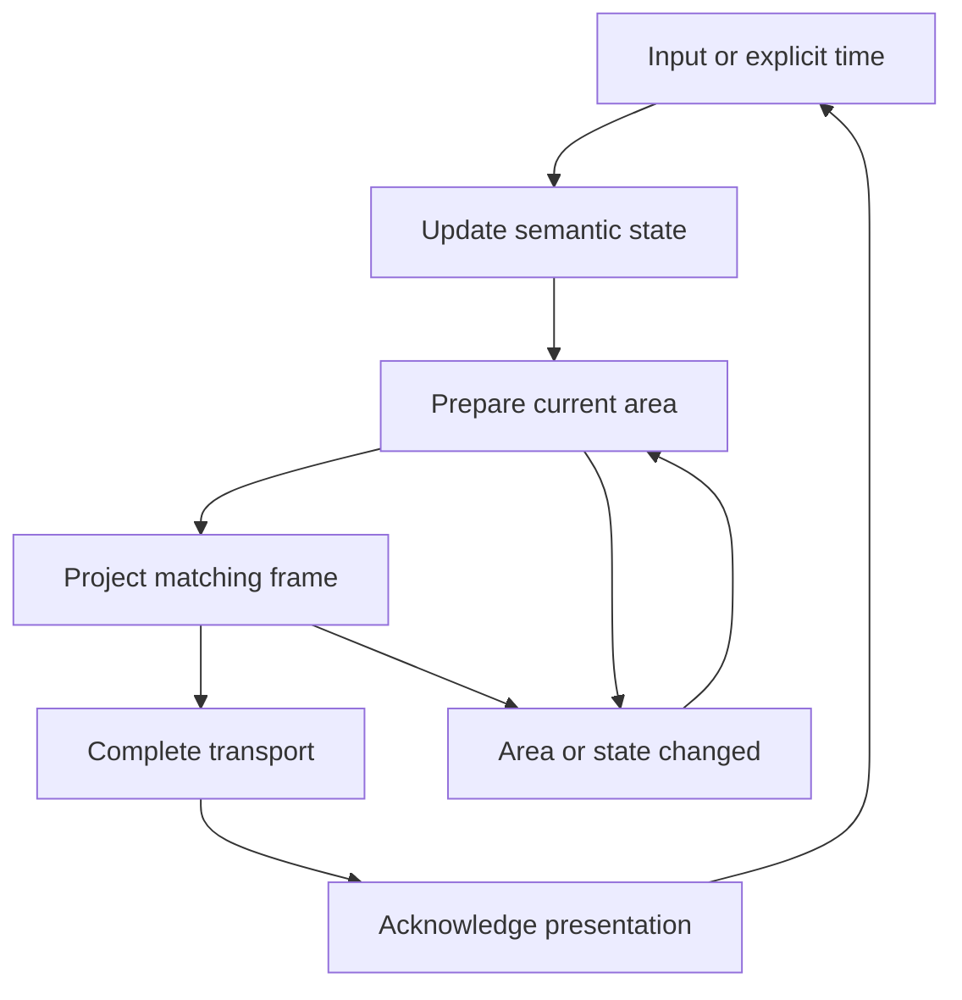

# Termrock target architecture

## Status and authority

This file specifies the target for PR #38. It does not report completed implementation.

- Target source: `e08ac57d10ae54c87337eae0be08b1f5e8f4bda4`.
- Product reference: `5b3dbd7ae799f325efbb4f4cc11b2f5518dec948`, PR #26.
- The target source supplies the modular starting point.
- The product reference supplies behavior, interaction, and visual requirements.
- The source review did not execute Rust tests. Rust and Cargo were absent.

Read [REVIEW.md](REVIEW.md) for defects. Use [PLAN.md](PLAN.md) for sequence and [TASKS.md](TASKS.md) for assignments. Use [API-RULES.md](API-RULES.md) for API contracts. Use [VALIDATION.md](VALIDATION.md) for acceptance. Track component scope in [COMPONENT-MATRIX.md](COMPONENT-MATRIX.md). Follow [AGENT-RUNBOOK.md](AGENT-RUNBOOK.md), [SOURCES.md](SOURCES.md), and [TESTING-RULES.md](TESTING-RULES.md). The testing rules govern conflicting test and source-comment instructions. Keep the other architecture contracts in this file.

## Decisions

1. Keep the 20 production library crates during this migration.
2. Give each behavior one implementation owner.
3. Keep the existing App, Cx, Ui, Response, and composition model.
4. Keep semantic state in the caller or its explicit component state.
5. Keep runtime-derived frame state and caches in the runtime.
6. Keep application data and workflows in application crates.
7. Borrow product behavior from PR #26. Do not restore its monolithic structure.
8. Make reusable component and foundation crates backend-free by default. Session is the backend owner and the explicit exception.
9. Make terminal session support an explicit facade feature.
10. Keep existing public aliases until their migration entry permits removal.
11. Retire application-specific library APIs through an explicit source migration.
12. Write API guidance in Markdown. Compile real example files.

These decisions authorize planned source and feature changes. They do not assert a published-version promise. Before changing a public path, record the old path, replacement, affected consumers, and tests. Do not infer permission to remove behavior from permission to remove a path.

## Crate boundary rules

The following table lists allowed direct normal dependencies. Prefix each short name with `termrock-`. The `termrock` facade has no suffix. An allowed edge is a ceiling. Remove the edge if source does not require it.

No production library crate may depend on an application, Showcase, test-support, conformance, visibility, or proof-tool crate. No crate below the facade may depend on the facade. Enforce these rules for target-specific and build dependencies too. Report dev-dependencies separately.

| Crate | Ownership | Allowed direct Termrock dependencies | Required migration |
|---|---|---|---|
| core | Identity; framework keys, events, intents, responses; validation errors; diagnostics; neutral policy values | None | Disable backend defaults. Keep optional backend conversion at a defined adapter boundary. |
| layout | Constraints, size, tracks, columns, split geometry, composition plans | core | Remove unused edges. Use ratatui-core value types. Keep runtime and widgets out. |
| theme | Tokens, roles, variants, part metrics, capability conversion, paint styles | core | Keep one resolution path. Classify product-specific profiles explicitly. |
| text | Grapheme editing, undo, width, wrapping, truncation, borrowed spans, secret display policy | core, theme | Keep widget and session types out. Remove unused ratatui umbrella dependency. |
| render | Pure patch merging; borrowed terminal source value types | core, theme | Remove unused layout/text edges. Share patch merging with runtime. |
| collections | Key sets; cursor and selection reconciliation; scroll state | core, layout | Remove unused layout/text edges after source checks. Define revision and invalidation rules. |
| runtime | App/Cx/Ui; input routing; frame state; focus; hit testing; capture; layers; clocks; composition execution; ScrollRegion | core, layout, theme, text, render, collections | Compile deterministic time without backend features. Keep family crates out. |
| controls | Buttons, choices, panels, properties, split mechanics, responsive master/detail mechanics, empty states | core, layout, theme, text, render, collections, runtime | Keep shared interaction and clipping here. Do not depend on overlays or forms. |
| fields | TextInput, TextArea, Field, Note, shared editing behavior | core, layout, theme, text, render, collections, runtime, controls | Keep edit, blur, validation, secret, and inherited-disabled rules together. |
| feedback | Status, hints, progress, meters, generic notices, text sections | core, layout, theme, text, render, collections, runtime, controls | Remove Jackin page models and page assembly. Add collections only if source requires it. |
| navigation | List, NavList, FilterList, Tree, Tabs, Steps, ChipBar, row adapters | core, layout, theme, text, render, collections, runtime, controls, fields, feedback | Keep stable-key state and bounded caches. Remove unused edges. |
| viewport | TextViewport and projected text | core, layout, theme, text, render, collections, runtime, controls | Keep the ScrollRegion public re-export. Runtime owns its implementation. |
| overlays | Select, picker, completion, dialogs, help, menus; widget layer policy | core, layout, theme, text, render, collections, runtime, controls, fields, feedback, navigation, viewport | Keep layer mechanics in runtime. Keep widget state here. |
| grid | Grid, Table, column schema, cell views, editing adapters | core, layout, theme, text, render, collections, runtime, controls, fields, feedback, navigation, overlays | Keep SQL and domain sorting outside this crate. |
| editors | CodeEditor, completing editor, DiffView, highlighting and extension hooks | core, layout, theme, text, render, collections, runtime, navigation, overlays, viewport | Preserve borrowed data and extension callbacks. |
| forms | FormData adapters, Form, FormDialog, Wizard | core, layout, theme, text, render, collections, runtime, controls, fields, feedback, navigation, overlays | Caller owns values. Forms own field traversal and validation flow. |
| terminal | TerminalView, selection, input tokens, terminal-content adaptation | core, layout, theme, text, render, collections, runtime, viewport | Move transport negotiation to session or core protocol values. Keep terminal content separate from terminal transport. |
| session | Terminal entry/exit, transport, backend input conversion, protocol negotiation, presentation acknowledgement | core, runtime, theme | Remove the terminal-widget dependency after the negotiation move. |
| shell | Page routing, leave guards, shell chrome, named slots, status/footer orchestration | core, layout, theme, runtime | Keep one AppShell implementation. Add reach tools only when T38 and a task plan approve them. |
| termrock | Family namespaces; convenience exports; typed composition adapters; generic blocks | All production library crates above | Add the feature scheme below. Keep application-specific models out. |

The graph is acyclic. Enforce exact edges from Cargo metadata. Do not accept source-import scanning as a substitute for dependency resolution. An app crate may use the facade. A pure domain or simulation crate may not use it.

### Backend boundary

Use `ratatui-core` for Rect, Position, Buffer, Cell, style, text, and Frame types that it owns. Keep the `ratatui` umbrella only where its production API is required. Put TestBackend-only imports in dev-dependencies.

`termrock-session` owns backend I/O and platform integration. It explicitly enables the core conversion feature. Core and runtime defaults must not pull Crossterm. Keep deterministic `Moment` and `ClockError` available in all configurations. The current `runtime.rs:3–7` gate is incorrect because its use is unconditional.

Remove misleading empty `crossterm` features when migration permits it. A temporary compatibility feature may remain. Its documented effect must be exact. It must not control deterministic time.

Move keyboard negotiation from `termrock-terminal` to `termrock-session`. Put only neutral protocol values or parsing in core when both owners use them. Session must not pull a TerminalView, TextViewport, or navigation component merely to enter the terminal.

### Keyboard delivery ownership

T09 adds the neutral `KeyboardDelivery` value in core and stores one snapshot per Runtime. It contains only the Alt and Super delivery answers. Its pure methods filter typed chords and existing literal hint labels. API-RULES section 7 fixes the exact method shapes.

Expose the snapshot through Runtime, Cx, and Ui. An explicit runtime setter invalidates prepared output and affected hints when the value changes. T12 uses it for tooltip shortcut labels. T19 uses it for shell hints and removes the shell globals.

T20 owns environment detection, probe answers, input observations, and actual protocol lifetime. It derives the runtime snapshot from those facts. Keep one session-owned KeyboardNegotiation with the existing neutral ProtocolState. Do not add a second pushed/enabled protocol state in Runtime.

T20 retires the core global protocol and capability mirrors through explicit migration entries. T19 adds `Footer::compose_with_delivery` and migrates callers to the owning runtime's snapshot. Keep `Footer::compose` temporarily as a conservative-default wrapper. The pure core value needs no session or shell dependency.

### Collection revision API

T14 adds `source_revision(Revision) -> Self` to List, NavList, and ChipBar. Reuse `termrock_core::Revision`. Keep existing update signatures and `invalidate()`. Propagate the value to one CollectionCore revision-aware reconciliation path.

The revision covers ordered keys and eligibility for one collection owner. Compare scroll extent separately. A source replacement under the same state must advance the revision or invalidate that state. Do not replace Tree query revisions or GridModel::revision. Apply the exact rules in API-RULES section 9.

### Button display and tooltip extension

T12 adds `Button::mnemonic(char)`, `Button::tooltip(&str)`, and `Button::tooltip_config(Tooltip)`. Runtime owns the borrowed Tooltip request type and its presentation state. Controls publishes requests through Ui. Keep the existing layer, clock, clipping, and binding mechanisms. Do not add a controls-to-overlays dependency.

The mnemonic builder changes display only. A plain tooltip shows text without a shortcut. An explicit Tooltip action opts into shortcut display. Controls passes its existing Binding table with the tooltip request. Runtime resolves its action and default chord through the current remapping and deliverability policy. This works for an unfocused hovered owner. It must not publish or enable that owner's bindings. Use the exact request and lifecycle rules in API-RULES section 12.

### Internal modules

A crate boundary and a file boundary serve different needs. Split large runtime files by lifecycle, routing, projection, and presentation responsibility. Keep private module boundaries. Do not add a crate for each helper.

Keep shared helpers near their owner. Do not build a miscellaneous `utils` crate. Do not add a generic trait until two concrete callers need its contract. Reuse the current CompositionLeaf and FieldControl traits. Do not add a second widget hierarchy.

## Facade feature design

This is a planned breaking feature migration. Update all workspace consumers in the same integration series. Keep the resulting public paths documented.

The facade has these mandatory foundation dependencies: core, layout, theme, text, render, collections, and runtime. It exposes identity, input, theme, layout, authoring, and headless runtime APIs with `default-features = false`.

Make each family dependency optional. Give each family one facade feature. Do not add features for individual widgets.

| Feature | Enables | Additional facade features |
|---|---|---|
| controls | termrock-controls | None |
| fields | termrock-fields | controls |
| feedback | termrock-feedback | controls |
| navigation | termrock-navigation | controls, fields, feedback |
| viewport | termrock-viewport | controls |
| overlays | termrock-overlays | controls, fields, feedback, navigation, viewport |
| grid | termrock-grid | controls, fields, feedback, navigation, overlays |
| editors | termrock-editors | navigation, overlays, viewport |
| forms | termrock-forms | controls, fields, feedback, navigation, overlays |
| terminal | termrock-terminal | viewport |
| shell | termrock-shell | None |
| components | All 11 family features above | None |
| session | termrock-session and the required backend adapter | None |
| testing | Test APIs in enabled dependencies | Do not enable a disabled component family |

Set `default = ["components"]`. Default consumers receive all reusable families. They receive no terminal session backend. The `terminal` feature means the terminal-content widget. The `session` feature means transport and terminal lifecycle.

Gate each family namespace and its convenience exports with its feature. Gate each composition adapter with its owner family. Gate blocks with the exact families they use. Gate session re-exports with `session`. Use weak dependency feature forwarding for testing when a family is optional. Do not let `testing` or a dev-dependency make a disabled production feature appear available in isolated checks.

Maintain the same types through each supported re-export. `termrock::controls::Button` and `termrock_controls::Button` must be the same type. A facade adapter must not copy component state or implement a second render path.

### Consumer checks

Build separate temporary Cargo projects outside the workspace for:

1. Foundation facade with no default features.
2. One control through the facade `controls` feature.
3. One direct family-crate consumer with defaults disabled where supported.
4. Each individual facade family feature.
5. Default `components`.
6. Explicit `session` with a minimal App.
7. Default components plus session, as used by the demonstration applications.

Inspect each resolved normal dependency graph. Backend-free variants must exclude crossterm, ratatui-crossterm, termrock-session, and platform transport dependencies. Do not impose a blanket ban on a library named `libc` without checking the resolved reason. Use an explicit forbidden backend graph, then explain any unrelated transitive package.

An approved isolated-consumer case must show that unsupported symbols fail at the intended feature boundary. A workspace-only result is insufficient because feature unification can hide missing gates. Plan any test or harness code under [TESTING-RULES.md](TESTING-RULES.md).

## State and frame protocol

Keep the existing protocol:

The diagram describes the successful transport path. Error and no-op branches still need the exact runtime contract.

- Update changes semantic component or domain state.
- Measure computes size. It does not paint or register interaction.
- Draw paints and publishes frame registrations. It may update derived caches and diagnostics.
- Draw does not commit edits, dispatch domain effects, or move semantic selection.
- Prepared output carries runtime, generation, and area identity.
- App or theme mutation invalidates prepared output.
- Projection checks the actual area.
- Transport acknowledgement publishes only matching output.
- Input remains blocked until the required presentation acknowledgement.
- Explicit time is monotonic. Backward time returns the typed error.

Preserve the current scope, modal, cursor, clipboard, drag, and wheel contracts. Do not collapse these into a raw-key callback in each app.

### Composition validation

Keep the existing layout resolver and measured leaf API. Add a validation hook to the current CompositionLeaf contract. Use a no-op default for an atomic custom leaf. Built-in nested leaves must report their nested depth and validate their children.

Validate a complete built-in composition before its first measure, paint, or registration operation. Preserve the bounded depth limit and safe drop. Remove silent error-to-zero behavior from normal composed paths. Return CompositionError at the checked public boundary. Keep the infallible Measure trait and require validation before direct nested-leaf use. A direct low-level invalid draw must emit a diagnostic and remain inert.

The facade must not maintain a second closure-leaf implementation. Reuse Runtime's ClosureLeaf. Keep a compatible facade name if callers use it. Keep distinct component adapters when their state or measurement contracts differ.

## Application boundaries

### Jackin

Move host account, settings, usage, and manager page assembly into `jackin-preview-host-ui`. Move capsule menu, session chrome, and zoom page assembly into `jackin-preview-capsule-ui`. Put projections used by both in `jackin-preview-presentation`.

Retain generic meter, row, panel, menu, field, clipping, and disclosure behavior in Termrock. Migrate the page in small sections. Each section must use those shared mechanisms before its old painter is retired.

Keep product fields in application models. These include DCO signoff, default agent, saved workspace target, provider quota, and capsule instance. A generic feedback API must not require them.

Remove the full facade from `jackin-preview-domain`. Replace secret wiping through the facade with the narrow existing owner. Remove UI StepState and presentation roles from simulation data. Map domain states into component states in presentation or UI code. Preserve simulated behavior and secret-handling contracts. T00 records old tests as historical inputs. Do not retain or run their code after T37. Use reviewed functional proof after T38.

### TablePro

Keep connection facts, schemas, result data, and domain decisions in `tablepro-domain`. Keep SQL interpretation in `tablepro-sql`. Move editor state, form construction, and GridModel/UI adapters into `tablepro-ui`.

Do not force domain data to implement UI behavior. A small UI adapter can borrow domain data. Preserve row keys, revision updates, validation, and edit failure behavior.

### Showcase and other applications

Showcase is a consumer and evidence surface. It must not become a library dependency. Holla, Jackin, TablePro, and Showcase may supply domain callbacks and custom authoring. They must not duplicate standard focus, keyboard, mouse, modal, scroll, or edit behavior.

A distinct product workflow can remain distinct. Shared ownership does not require one generic application controller.

## Public path migration

| Path group | Disposition |
|---|---|
| Existing root component aliases | Keep temporarily. Add feature gates. Prefer family namespaces in new examples. |
| Family namespace exports | Keep. Expose the canonical owner type. |
| Runtime authoring helpers at root | Keep compatibility where legal. Teach `termrock::author` as the normal advanced path. |
| AppShell facade aliases | Keep. They already point to termrock-shell. Keep one implementation. |
| MasterDetail control and block | Keep distinct roles. The control owns responsive mechanics. The block composes groups. They already share state. Explain their paths. |
| PropsList via navigation | Keep compatibility alias. Record controls as implementation owner. |
| ScrollRegion via viewport | Keep compatibility alias. Record runtime as implementation owner. |
| PartStyle at render and runtime | Share pure merge logic. Retain different wrappers only for distinct slot/painting needs. |
| Facade Leaf and runtime ClosureLeaf | Unify implementation. Preserve the facade constructor/path until migration permits removal. |
| Application-specific feedback APIs | Replace with app-owned assembly and generic controls. Track each removed path explicitly. Do not add a reverse app dependency. |
| Session root exports | Gate with explicit session feature. Update all application manifests and examples. |
| Global keyboard capability accessors | Retire through T19/T20 migration rows. Use per-runtime KeyboardDelivery and session-owned observation state. |
| Footer::compose | Keep a conservative-default wrapper. Migrate normal callers to compose_with_delivery with their runtime snapshot. |
| Test-only surfaces | Add only when T38 and a task plan approve them. Gate them under testing. Never use them in production consumer proof. |

Do not remove documented compatibility because a symbol scan finds no in-repository caller. The migration record must identify scope and intended source break. Do not keep an architecture violation forever merely to preserve an accidental export.

## Acceptance for this architecture

The architecture is complete only when all of these conditions hold:

- The normal dependency graph matches the allowlist.
- Isolated feature consumers compile with the intended graph.
- Library crates contain no application page models or workflow policy.
- Every public component and block has an implementation owner.
- All aliases and retired paths have a recorded disposition.
- Current examples use the public facade and supported family paths.
- Approved cases verify semantic state and the presentation protocol.
- Approved cases verify borrowed callbacks and custom parts.
- Approved cases verify identity and bounded-work contracts after migration.
- The product acceptance matrix still satisfies the reference behavior.

Plan every test or harness edit under [TESTING-RULES.md](TESTING-RULES.md). Record fresh evidence at the final reviewed source commit. Historical tests, captures, and counts remain provenance. They do not establish these conditions for a new commit.

## Source basis

These sources establish the starting point. The tables above specify planned changes.

- [Workspace members and dependencies](https://github.com/tailrocks/terminal-components-claude/blob/e08ac57d10ae54c87337eae0be08b1f5e8f4bda4/Cargo.toml).
- [Current facade features and dependencies](https://github.com/tailrocks/terminal-components-claude/blob/e08ac57d10ae54c87337eae0be08b1f5e8f4bda4/crates/termrock/Cargo.toml#L8-L33).
- [Core protocol and delivery globals](https://github.com/tailrocks/terminal-components-claude/blob/e08ac57d10ae54c87337eae0be08b1f5e8f4bda4/crates/termrock-core/src/keys.rs#L220-L423) and [shell delivery globals](https://github.com/tailrocks/terminal-components-claude/blob/e08ac57d10ae54c87337eae0be08b1f5e8f4bda4/crates/termrock-shell/src/keyboard.rs#L8-L78).
- [Incorrect clock feature gate](https://github.com/tailrocks/terminal-components-claude/blob/e08ac57d10ae54c87337eae0be08b1f5e8f4bda4/crates/termrock-runtime/src/runtime.rs#L1-L8).
- [Feedback page exports](https://github.com/tailrocks/terminal-components-claude/blob/e08ac57d10ae54c87337eae0be08b1f5e8f4bda4/crates/termrock-feedback/src/lib.rs#L17-L92).
- [App-specific settings facts](https://github.com/tailrocks/terminal-components-claude/blob/e08ac57d10ae54c87337eae0be08b1f5e8f4bda4/crates/termrock-feedback/src/settings_page.rs#L38-L74).
- [Canonical shell implementation](https://github.com/tailrocks/terminal-components-claude/blob/e08ac57d10ae54c87337eae0be08b1f5e8f4bda4/crates/termrock-shell/src/shell.rs#L95-L135) and [facade aliases](https://github.com/tailrocks/terminal-components-claude/blob/e08ac57d10ae54c87337eae0be08b1f5e8f4bda4/crates/termrock/src/blocks/shell.rs#L1-L44).
- [Current ownership and compatibility decisions](https://github.com/tailrocks/terminal-components-claude/blob/e08ac57d10ae54c87337eae0be08b1f5e8f4bda4/docs/decisions.md).
